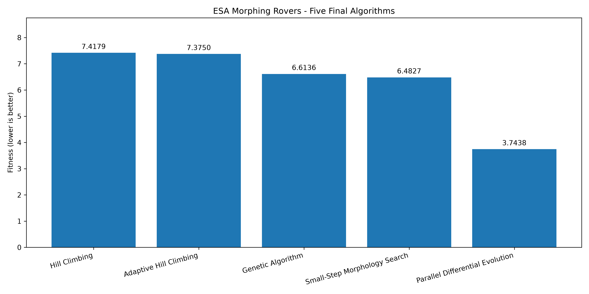
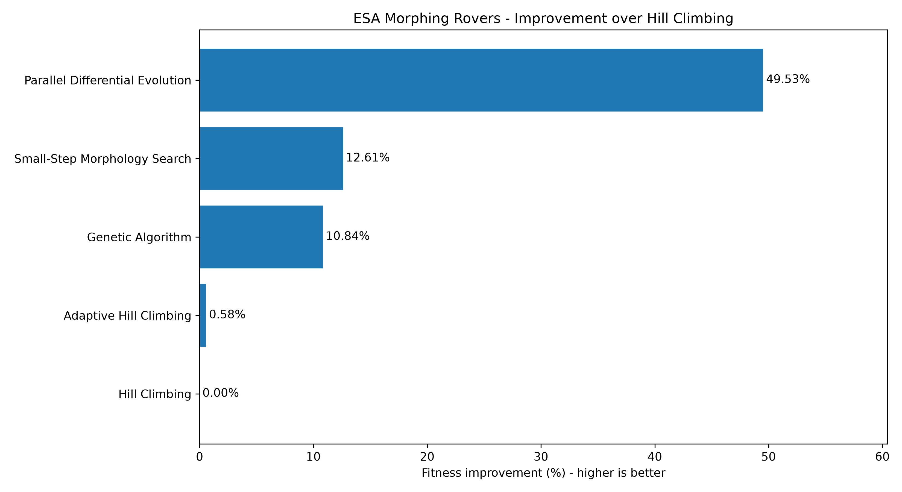
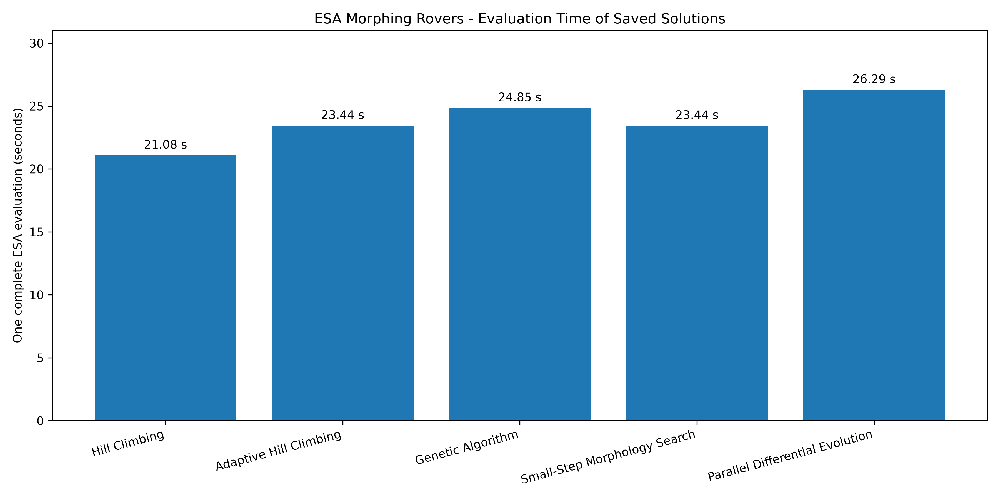
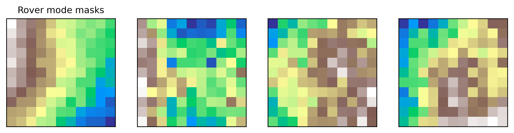
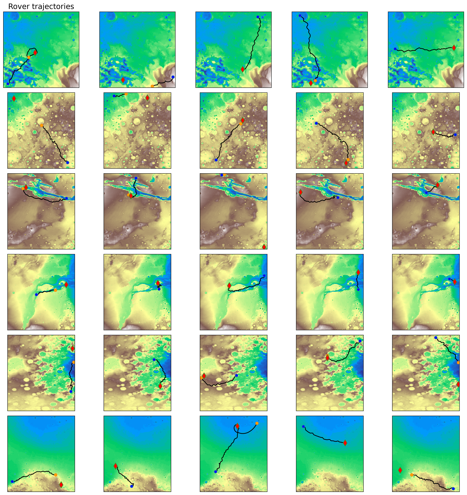
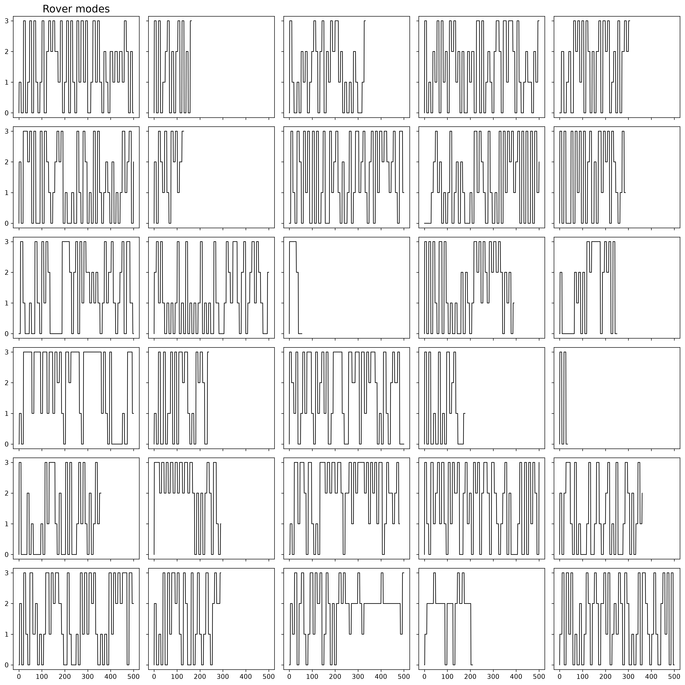
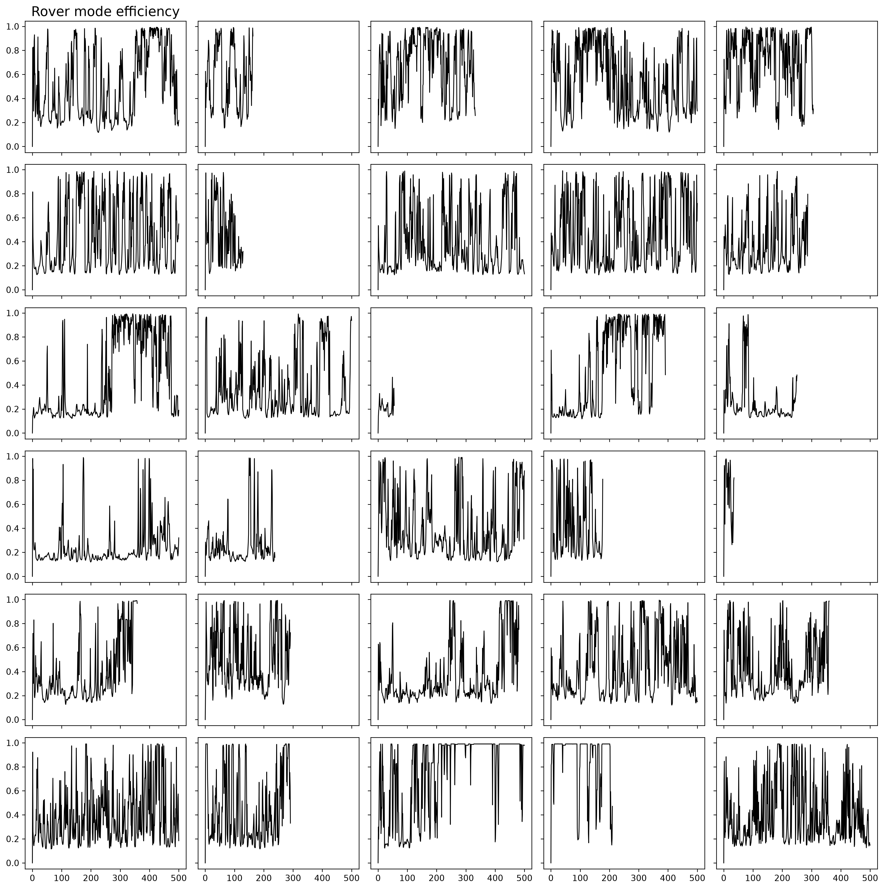

# ESA Morphing Rovers

This project explores five optimization algorithms for the **ESA SpOC 2 – Morphing Rovers** challenge.

The goal is to find a rover configuration that travels efficiently across different terrains and collects samples. The ESA simulator tests the same rover on **30 scenarios across 6 maps**. Each rover has **4 movement modes** controlled by a neural network.

## Algorithms

The project includes five methods:

1. **Hill Climbing** – makes small random changes to improve a rover.
2. **Adaptive Hill Climbing** – adjusts the size of those changes during the search.
3. **Genetic Algorithm** – uses a population, mutation and crossover.
4. **Small-Step Morphology Search** – improves the rover's terrain-mode parameters.
5. **Parallel Differential Evolution** – searches with a population and evaluates candidates in parallel.

The Python scripts are in `algorithms/`. 

## Results

All five saved rovers were evaluated with the ESA simulator on the full 30-scenario setup. **Lower fitness is better.**

| Rank | Algorithm | Fitness |
|---|---|---:|
| 1 | **Parallel Differential Evolution** | **3.743782** |
| 2 | Small-Step Morphology Search | 6.482726 |
| 3 | Genetic Algorithm | 6.613619 |
| 4 | Adaptive Hill Climbing | 7.374997 |
| 5 | Hill Climbing | 7.417877 |

The best saved rover is `final_results/multistart_ga_v4_best_rover.npy`.

These numbers compare the **saved final rover configurations**, not the average performance of each algorithm over repeated runs.

## Comparison Charts

**Fitness comparison** (lower is better):



**Improvement compared with Hill Climbing:**



**Time to evaluate each saved rover:**



*Evaluation time is for one complete ESA fitness evaluation, not the total time spent optimizing.*

CSV data is available in `analysis/outputs/`.

## Rover Visualizations

These images show the **best saved rover** in the ESA simulator.

**Rover modes**



**Rover trajectories**



**Rover mode changes**



**Rover mode efficiency**



## Project Structure

```text
algorithms/             Five optimization scripts and seeds/
analysis/               Scripts for evaluation and comparison
analysis/outputs/       CSV results and comparison charts
final_results/          Five saved best rover configurations (.npy)
results/                Rover visualization images
data/                   ESA maps and coordinates (local only)
morphing_udp.py         ESA simulation code
test_rover.py           Basic simulator test
morphing_description.md ESA challenge description
requirements.txt       Python dependencies
README.md              Project documentation
```

## How to Run

Use **Python 3.11**. In Windows PowerShell, from the project folder:

```powershell
py -3.11 -m venv .venv
.\.venv\Scripts\Activate.ps1
python -m pip install -r requirements.txt
```

The ESA input data must be placed in `data/` (`Maps/`, `coordinates.txt`, and `example_rover.npy`).

This folder is not included in GitHub. See `morphing_description.md` for the challenge data information.

If the CPU-specific PyTorch packages cannot be installed directly, use the [official PyTorch installation instructions](https://pytorch.org/get-started/locally/).

To test and recreate the comparison charts:

```powershell
python test_rover.py
python -m analysis.evaluate_results
python -m analysis.compare_algorithms
python -m analysis.analyze_comparison
python -m analysis.plot_results
```

To verify the saved morphology refinement without starting a new optimization:

```powershell
python -m algorithms.small_step_morphology --verify
```

Full optimization runs can take much longer. The saved `.npy` configurations in `final_results/` are kept separate from new trial files.

## Credits

The challenge description and simulation code are provided by the **European Space Agency (ESA), Advanced Concepts Team**, for the **SpOC 2 – Morphing Rovers** challenge.

The optimization methods and comparison scripts are the work in this repository.

Challenge resources: [ESA SpOC2 GitHub](https://github.com/esa/SpOC2).
